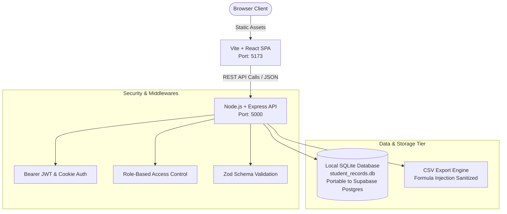

# Cloud-Based Student Record System

<div align="center">


**Sant Gajanan Maharaj Education Trust's**  
**Annasaheb Dange College of Engineering and Technology (ADCET), Ashta**  
*Department of Artificial Intelligence and Data Science*  
**Course:** 1ADHS403 · **ISE Activity 2** · **Group 5**

</div>

---

## 📌 Executive Summary

The **Cloud-Based Student Record System** is a secure, high-performance, web-based institutional record platform engineered for engineering colleges (~1,200 students and 80 faculty). It replaces fragmented paper registers and departmental data silos with a single source of truth for:
- Student admissions and lifecycle management (`ACTIVE`, `DETAINED`, `ON_LEAVE`, `GRADUATED`).
- Lecture attendance tracking with automated `< 75%` threshold flagging.
- Examination scheduling, draft grading, and result publication locking with audit trails.
- Financial fee ledger with integer-paise accounting and atomic receipt generation.
- Accreditation reports (Attendance, Grade transcripts, Defaulters list) with CSV exports.

---

## 🏛️ System Architecture



---

## 🛡️ Key Senior Engineering Safeguards

| Domain | Safeguard Implemented | Rationale & Architecture |
| :--- | :--- | :--- |
| **Financial Accuracy** | **Integer-Paise Accounting** | All currency is stored in whole integer paise (e.g. ₹85,000 = `8500000`). Completely eliminates IEEE 754 floating-point rounding errors. |
| **Sequential Receipts** | **Atomic Sequence Counter** | Receipt codes (`REC/2026-2027/000001`) are generated inside isolated database transactions to eliminate race conditions and numbering gaps. |
| **Ledger Integrity** | **Append-Only Accounting** | Ledger entries are never overwritten or deleted. Financial corrections require explicit offset entries (`WAIVER`, `REFUND`, `REVERSAL`). |
| **Attendance Window** | **7-Day Edit Restriction** | Faculty can update attendance records within 7 days of the lecture. Subsequent updates are locked and require administrative approval. |
| **Exam Transparency** | **Publication Lock & Revisions** | Once exam marks are published to students, scores cannot be modified silently. Any modification writes to `result_revisions` with a reason. |
| **Export Protection** | **CSV Formula Injection Sanitizer** | Any cell starting with `=, +, -, @, \t, \r` is prepended with `'` to prevent malicious formula execution in Microsoft Excel. |
| **Zero-Setup Database** | **Local SQLite Engine** | Uses `@libsql/client` (pure JavaScript, zero native C++ compiler dependency) with automated schema creation and demo seeding on boot. |

---

## 👥 Role-Based Access Control (RBAC) Matrix

| Feature / Resource | Student | Faculty | Accounts | Registrar / Admin | Super Admin |
| :--- | :---: | :---: | :---: | :---: | :---: |
| **View Own Profile, Attendance & Results** | ✅ | ✅ | ✅ | ✅ | ✅ |
| **Manage Student Profiles (CRUD)** | ❌ | ❌ | ❌ | ✅ | ✅ |
| **Conduct & Record Attendance Sessions** | ❌ | ✅ | ❌ | ✅ | ✅ |
| **Submit Draft Marks & Enter Scores** | ❌ | ✅ | ❌ | ✅ | ✅ |
| **Publish Exam Results to Students** | ❌ | ❌ | ❌ | ✅ | ✅ |
| **Record Fee Payments & Issue Receipts** | ❌ | ❌ | ✅ | ✅ | ✅ |
| **Manage Fee Structures & Adjustments** | ❌ | ❌ | ✅ | ✅ | ✅ |
| **Export CSV Reports (Attendance, Grades)** | ❌ | ✅ | ❌ | ✅ | ✅ |
| **Export Fee Defaulters List** | ❌ | ❌ | ✅ | ✅ | ✅ |
| **Access System Audit Logs** | ❌ | ❌ | ❌ | ❌ | ✅ |

---

## 💻 Tech Stack

### Frontend
- **Framework:** React 18 (TypeScript)
- **Tooling:** Vite 6
- **Routing:** React Router DOM v6
- **Icons:** Lucide React
- **Design Tokens:** PRD Light Theme (`#F8FAFC` page background, `#1E3A8A` primary navy, `#2563EB` accent blue, `#0F172A` text)

### Backend API
- **Runtime:** Node.js (20+ LTS)
- **Framework:** Express.js (TypeScript)
- **Validation:** Zod Schema Validation
- **Authentication:** JWT Access Tokens (15m) + `httpOnly` Refresh Token Rotation
- **Security:** Helmet, CORS, Rate-Limiting, Bcryptjs Password Hashing
- **Bundler:** `tsup` (esbuild-powered, 46 KB bundle, < 100ms build)

### Database
- **Local:** SQLite 3 (via `@libsql/client`, 100% offline, ₹0 cost)
- **Cloud-Ready:** PostgreSQL on Supabase (Singapore region, with RLS and schema mirror)

---

## ⚡ Quick Start Guide

### Prerequisites
- Node.js `v20.x` or higher installed
- npm `v10.x` or higher installed

### 1. Clone the Repository
```bash
git clone https://github.com/amitryedage/PMF-Project.git
cd PMF-Project
```

### 2. Install Dependencies
```bash
# Install root orchestration tools
npm install

# Install backend dependencies
cd server
npm install
cd ..

# Install frontend dependencies
cd client
npm install
cd ..
```

### 3. Run the System

Open two terminal tabs:

**Terminal 1 (Backend API):**
```bash
npm run dev:server
```
*API will start on `http://localhost:5000` with local SQLite database initialized.*

**Terminal 2 (Frontend Client):**
```bash
npm run dev:client
```
*Vite web portal will start on `http://localhost:5173`.*

---

## 🔑 Pre-Seeded Demo Credentials

All test accounts come pre-configured with the default password: **`Admin@12345`**

| Role | Email / Login Identifier | Default Password | What to Test |
| :--- | :--- | :--- | :--- |
| **Super Admin** | `superadmin@adcet.in` | `Admin@12345` | System audit logs, user management |
| **Registrar (Admin)** | `registrar@adcet.in` | `Admin@12345` | Student records, publish exam results |
| **Accounts Officer** | `accounts@adcet.in` | `Admin@12345` | Fee collection, receipts, defaulters list |
| **Faculty Member** | `faculty.ai@adcet.in` | `Admin@12345` | Mark lecture attendance, enter test marks |
| **Student** | `student.demo@adcet.in` | `Admin@12345` | Personal attendance %, SGPA grade card, dues |

*(The login screen also features 1-click quick login buttons for all these roles).*

---

## 📡 API Endpoint Summary

### Authentication (`/api/v1/auth`)
- `POST /login` - Sign in via email or roll number + password.
- `POST /refresh` - Silent refresh token rotation via httpOnly cookie.
- `POST /logout` - Revokes refresh token in database.
- `POST /change-password` - Strong password validation (min 10 chars, upper, lower, number, special).
- `GET /me` - Returns active session profile and student metadata.

### Students (`/api/v1/students`)
- `GET /` - Paginated student directory with search (`name`, `roll`, `enrollment`) and filters.
- `GET /:id` - Get student profile (enforces student IDOR privacy).
- `POST /` - Transactional student onboarding + linked user account creation.
- `PUT /:id` - Profile field updates.
- `DELETE /:id` - Soft-delete student record.

### Attendance (`/api/v1/attendance`)
- `POST /sessions` - Schedule lecture session with faculty assignment check.
- `POST /records` - Bulk submit student attendance (enforces 7-day edit window).
- `GET /student/:studentId` - Subject-wise attendance calculation with `< 75%` defaulter warning.

### Examinations & Marks (`/api/v1/marks`)
- `POST /exams` - Schedule an exam with max-marks constraints.
- `POST /entry` - Faculty draft mark entry (enforces `score <= max_marks`).
- `POST /exams/:examId/publish` - Locks results and releases them to students.
- `POST /revise` - Post-publication mark correction with revision audit log.
- `GET /student/:studentId` - SGPA, distinction calculation, and grade card.

### Fee Ledger (`/api/v1/fees`)
- `POST /structures` - Program fee structure definition in integer paise.
- `POST /payments` - Records payment with atomic sequential receipt number (`REC/YYYY-YYYY/xxxxxx`).
- `POST /adjustments` - Records waiver, refund, charge, or reversal entries.
- `GET /student/:studentId/dues` - Real-time dues balance calculation.
- `GET /student/:studentId/ledger` - Append-only student financial audit history.

### Reports & Exports (`/api/v1/reports`)
- `GET /attendance` - Class attendance register (`?format=csv` for Excel download).
- `GET /grades` - Exam performance report (`?format=csv` for Excel download).
- `GET /defaulters` - Outstanding fee defaulters list (`?format=csv` for Excel download).
- `GET /audit` - Super Admin security and change audit trail.

---

## 📂 Project Directory Structure

```
PMF-Project/
├── .gitignore                      # Git exclusion rules
├── .env.example                    # Environment variable reference
├── package.json                    # Workspace scripts
├── README.md                       # Complete documentation
│
├── server/                         # Node.js + Express + TypeScript API
│   ├── database/
│   │   ├── schema.sql              # PostgreSQL production schema
│   │   ├── sqlite_schema.sql       # Local SQLite schema
│   │   ├── sqlite_seed.sql         # Base seed accounts
│   │   └── seed_rich_data.ts       # 20 realistic student profiles & records
│   ├── src/
│   │   ├── config/                 # Env validation, SQLite db connection, constants
│   │   ├── middlewares/            # Auth, RBAC, Zod validation, Error handling
│   │   ├── modules/
│   │   │   ├── auth/               # Login, JWT rotation, session management
│   │   │   ├── students/           # Student master data CRUD & pagination
│   │   │   ├── attendance/         # Sessions, bulk recording, 7-day rules
│   │   │   ├── marks/              # Exams, grading, SGPA, revision audit
│   │   │   ├── fees/               # Integer paise ledger & receipts
│   │   │   └── reports/            # CSV exports & formula sanitization
│   │   ├── utils/                  # Cryptography, tokens, response helpers
│   │   ├── app.ts                  # Express application setup
│   │   └── index.ts                # Server bootstrapper & SQLite auto-init
│   ├── package.json
│   └── tsconfig.json
│
└── client/                         # React 18 + Vite + TypeScript Frontend
    ├── index.html                  # HTML entry point (Inter font)
    ├── vite.config.ts              # Vite proxy configuration
    ├── src/
    │   ├── api/client.ts           # Fetch client with auto 401 refresh
    │   ├── context/AuthContext.tsx # React auth state provider
    │   ├── components/layout/      # Navbar, Sidebar, Layout wrappers
    │   ├── pages/                  # Login, Dashboard, Students, Attendance,
    │   │                           # Marks, Fees, Reports
    │   ├── types/index.ts          # Shared TypeScript models
    │   ├── index.css               # PRD light-theme CSS tokens & styling
    │   └── main.tsx                # React DOM mount point
    ├── package.json
    └── tsconfig.json
```

---

## 👨‍💻 Project Team (Group 5)

| Name | Role | Responsibilities |
| :--- | :--- | :--- |
| **Jagjeevan Kashid** | Project Manager | Project scheduling, branch protection, governance |
| **Amit Yedage** | Tech Lead & Systems Architect | Backend architecture, database engine, RBAC & security |
| **Samarth Shinde** | Tech Lead & Finance Lead | Frontend components, fee ledger schema, UI tokens |
| **Riddhi Potdar** | Risk & Quality Lead | Testing strategies, edge case audits, compliance checks |

---

<div align="center">
  <sub>Built with  by Group 5 · Dept. of AI and Data Science · ADCET Ashta</sub>
</div>
